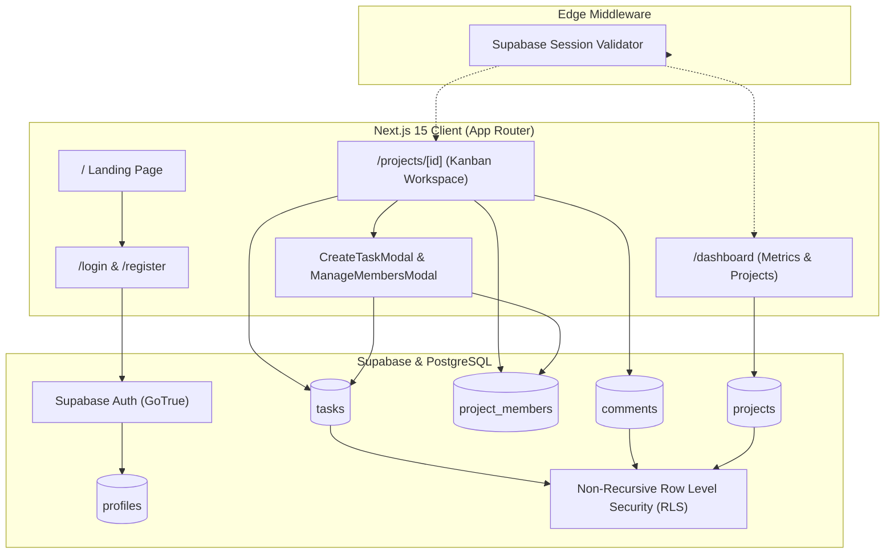

# TaskFlow &mdash; Collaborative Project & Task Management Tool

[](https://nextjs.org/)
[](https://react.dev/)
[](https://www.typescriptlang.org/)
[](https://tailwindcss.com/)
[](https://supabase.com/)
[](https://www.codealpha.tech/)

> **TaskFlow** is a full-stack, collaborative project management web application inspired by Trello and Asana. Designed and built from scratch as part of the **CodeAlpha Internship (Task 3 &mdash; Project Management Tool)**.

---

## 🌟 Key Features

### 1. Authentication & User Profiles
- **Secure Supabase Auth:** Email and password authentication with server-side cookie sessions (`@supabase/ssr`).
- **Profile Synchronization:** Automated PostgreSQL trigger (`handle_new_user`) that auto-populates user profiles from `auth.users` upon registration.
- **Middleware Protected Routes:** Route guarding on `/dashboard` and `/projects/:id` that transparently redirects unauthenticated requests to `/login`.

### 2. Project Workspace & KPI Metrics
- **Dynamic Dashboard:** Real-time KPI summary cards (*Total Projects*, *Completed Tasks*, *Active Tasks*, *Team Members*).
- **Asynchronous Project Creation:** Add deliverables with title, description, and auto-membership association.
- **Dynamic Search & Filtering:** Filter projects by workflow status (*All*, *In Progress*, *Completed*, *Planning*) and live search query.
- **Zero-Project Empty States & Skeletons:** Graceful UX with animated skeleton loaders during query resolution.

### 3. Interactive Kanban Task Board
- **3-Column Workflow:** Standardized lanes for **To Do**, **In Progress**, and **Done**.
- **HTML5 Drag-and-Drop:** Intuitive card dragging across columns with optimistic UI updates and active drop targets.
- **1-Click Quick Move Actions:** Swift status progression buttons on card hover (*Start Task*, *Complete*, *Reopen*).
- **Real-Time Workspace Progression:** Dynamic progress bar in the project header that calculates percentage completion as tasks shift columns.
- **Priority Labels & Indicators:** Color-coded priority badges (`High`, `Medium`, `Low`), due date indicators, and overdue warnings.

### 4. Team Collaboration & Discussion
- **Threaded Task Comments:** Task-specific discussions inside the task details modal connected to the `comments` table.
- **Optimistic Posting:** Comments render instantaneously with author initials, name tag, and relative timestamps (*"Just now"*, *"10m ago"*).
- **Keyboard Shortcuts:** `Ctrl + Enter` (or `Cmd + Enter`) quick-submit for seamless team chatting.
- **Project Contributor Management:** Invite registered teammates by email, inspect roles (`Owner`, `Admin`, `Member`), update permissions, or remove collaborators.

### 5. Enterprise-Grade Database & Security
- **PostgreSQL Database:** Relational schema with normalized tables (`profiles`, `projects`, `project_members`, `tasks`, `comments`).
- **Row Level Security (RLS):** Non-recursive, performance-optimized security policies backed by `SECURITY DEFINER` helper functions (`is_project_member`, `is_project_admin_or_owner`).
- **Integrity Constraints & Triggers:** Foreign key constraints, assignee validation guards, and self-elevation prevention.

---

## 🏗️ System Architecture



---

## 🗄️ Database Schema & Security

| Table | Description | Key Relationships & Constraints | RLS Enforcement |
| :--- | :--- | :--- | :--- |
| **`profiles`** | User metadata & credentials info | PK `id` references `auth.users(id) ON DELETE CASCADE` | Viewable by authenticated users; update self only |
| **`projects`** | Project workspaces & owners | `owner_id` references `profiles(id)` | Viewable/editable only by project members/owners |
| **`project_members`** | Workspace membership & roles | Unique `(project_id, user_id)`, roles: `owner`, `admin`, `member` | Viewable by members; manageable by owners/admins |
| **`tasks`** | Deliverables & Kanban cards | `project_id` &rarr; `projects(id)`, `assigned_to` &rarr; `profiles(id)` | Only project members can view, create, edit, or delete |
| **`comments`** | Threaded task conversations | `task_id` &rarr; `tasks(id)`, `user_id` &rarr; `profiles(id)` | Readable by project members; editable/deletable by author |

---

## 🛠️ Tech Stack & Libraries

- **Framework:** [Next.js 15](https://nextjs.org/) (App Router, Server Actions, Route Handlers)
- **Library:** [React 19](https://react.dev/)
- **Language:** [TypeScript 5](https://www.typescriptlang.org/) (Strict typing)
- **Styling:** [Tailwind CSS 3.4](https://tailwindcss.com/)
- **Icons:** [Lucide React](https://lucide.dev/)
- **Backend & Auth:** [Supabase](https://supabase.com/) (`@supabase/supabase-js`, `@supabase/ssr`)
- **Database:** PostgreSQL with Row Level Security (RLS)
- **Linting & Code Quality:** ESLint 9

---

## 🚀 Getting Started

### 1. Prerequisites
- [Node.js](https://nodejs.org/) (v18.18+ or v20+ recommended)
- A free [Supabase](https://supabase.com/) account

### 2. Clone Repository
```bash
git clone https://github.com/DIPIKASARDAR2004/CodeAlpha_ProjectManagementTool.git
cd CodeAlpha_ProjectManagementTool
```

### 3. Install Dependencies
```bash
npm install
```

### 4. Configure Environment Variables
Create a `.env.local` file in the project root:
```env
NEXT_PUBLIC_SUPABASE_URL=https://your-supabase-project-id.supabase.co
NEXT_PUBLIC_SUPABASE_ANON_KEY=your-supabase-anon-key
```

### 5. Setup Database Schema
1. Open your Supabase Dashboard &rarr; **SQL Editor**.
2. Run the SQL script located at:
   ```text
   supabase/migrations/001_initial_schema.sql
   ```
3. Disable email confirmation under **Authentication &rarr; Providers &rarr; Email &rarr; Confirm email** (optional, recommended for fast local testing).

### 6. Run Development Server
```bash
npm run dev
```
Open **[http://localhost:3000](http://localhost:3000)** in your browser.

---

## 🧪 Testing & Verification

Run automated linting, type checks, and production builds:

```bash
# Lint check
npm run lint

# TypeScript verification
npx tsc --noEmit

# Production build
npm run build
```

---

## 👩‍💻 Author & Internship Details

- **Author:** Dipika Sardar
- **Program:** CodeAlpha Internship
- **Track:** Web Development
- **Task:** Task 3 &mdash; Project Management Tool
- **Repository:** [https://github.com/DIPIKASARDAR2004/CodeAlpha_ProjectManagementTool](https://github.com/DIPIKASARDAR2004/CodeAlpha_ProjectManagementTool)

